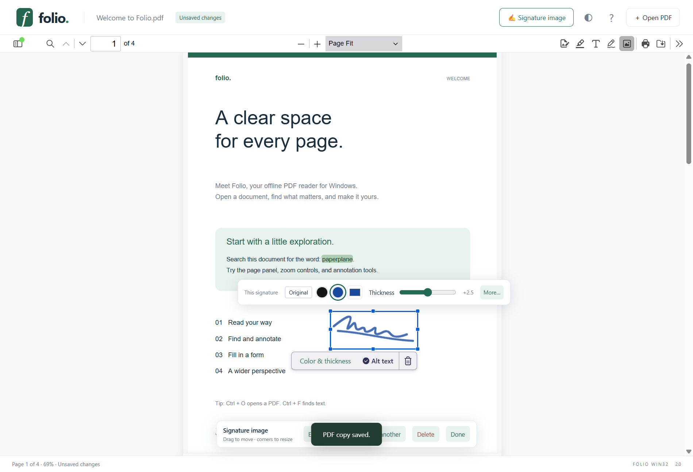

# Folio

[](https://github.com/ilantwig/folio-pdf-reader/actions/workflows/windows.yml)

**A clear space for every PDF.** A local PDF reader for Windows with annotations, forms, and image signatures you can style directly on the page.

[Download for Windows](https://github.com/ilantwig/folio-pdf-reader/releases/latest) · [Build from source](#build-from-source) · [Report a bug](https://github.com/ilantwig/folio-pdf-reader/issues/new/choose)



## What it does

- Read PDFs with selectable text, search, thumbnails, bookmarks, zoom, rotation, and page layouts.
- Fill forms, annotate, print, and save a PDF copy with your changes embedded.
- Import a signature image; place, move, and resize it anywhere on a page.
- Select a placed signature to edit its **color and thickness inline**, independently of other copies.
- Keep reusable signature templates; undo and redo edits.
- Open password-protected PDFs and restore your place from recent files.
- Use light or dark mode. Read and edit local files offline.

Folio has a **native C++/Win32 x64 host** and a locally bundled **PDF.js interface inside WebView2**. It does not use .NET, WinForms, WPF, or Electron. Its controls are web based; it is not an all-Win32-widget interface.

## Download and run

1. Download **Folio-Win32-2.0-x64.zip** from [Releases](https://github.com/ilantwig/folio-pdf-reader/releases/latest).
2. Right-click the ZIP and choose **Extract All**.
3. Open the extracted folder and run **Folio.exe**. Keep the `Assets` folder and `WebView2Loader.dll` beside it.

**Requirements:** Windows 10 or 11 x64 and an up-to-date [Microsoft Edge WebView2 Evergreen Runtime](https://developer.microsoft.com/microsoft-edge/webview2/) (version 145 or newer). If the runtime is missing or too old, Folio offers to open Microsoft's download page. No .NET or separate Visual C++ runtime installation is required.

This is an unsigned community build. Windows may display an unknown publisher notice. SHA-256 checksums accompany release downloads. ARM64, 32-bit Windows, macOS, and Linux builds are not currently provided.

## Sign a PDF

Choose **Signature image** to import an image, then place it on a page. Drag to move it and use the corner handles to resize. Select the placed signature to reveal its color swatches and thickness slider. **More** opens additional appearance controls.

Use **Save PDF copy** to embed your changes. Image signatures are visual marks, not certificate-based digital signatures. Editing signed or restricted PDFs can affect their validity or be limited by the document.

## Your files stay local

Folio does not upload your PDFs to a document service. Viewer assets are bundled, external viewer resource requests are blocked, and opening a document link in another application asks first. WebView2 installation and runtime updates use Microsoft's services.

Preferences, recent paths, and the WebView2 signature library are stored in `%LOCALAPPDATA%\Folio`. Share the app ZIP rather than that profile directory. See [Privacy](docs/PRIVACY.md) for details.

## Build from source

Use Windows x64, PowerShell, and the pinned LLVM-MinGW UCRT toolchain. The setup script downloads the official archive and checks its SHA-256 before extraction. Viewer assets, SDK headers, and licenses are vendored, so there is no npm install or .NET SDK step.

```powershell
git clone https://github.com/ilantwig/folio-pdf-reader.git
cd folio-pdf-reader
.\scripts\setup-toolchain.ps1
.\build.ps1
.\dist\Folio-Win32-2.0-x64\Folio.exe
```

Already have LLVM-MinGW? Run `./build.ps1 -Toolchain 'C:\path\to\llvm-mingw\bin'` instead. See [Development](docs/DEVELOPMENT.md) for the toolchain pin, project layout, and packaging.

## Test

```powershell
.\scripts\check-native.ps1
.\test.ps1
```

The native integration suite opens a separate test window and uses an isolated profile. It checks rendering, search, forms, annotations, per-instance signature styling, undo/redo, save/reopen, encryption, malformed files, Unicode paths, recent-file persistence, and the absence of the CLR. The initial native release passed **104 integration checks** locally. Reports and screenshots are written under `test-results/`, which is ignored by Git.

## Contribute

Bug reports and focused pull requests are welcome. Start with [CONTRIBUTING.md](CONTRIBUTING.md), the [architecture](docs/ARCHITECTURE.md), and the [code of conduct](CODE_OF_CONDUCT.md). Report security issues through [SECURITY.md](SECURITY.md). There is no telemetry-backed crash collection; a useful issue includes reproduction steps and a redacted screenshot or synthetic sample PDF.

## License and credits

Folio's original code is [MIT licensed](LICENSE.txt), copyright 2026 Ilan Twig and Folio contributors. Bundled dependencies keep their own licenses. Folio uses [Mozilla PDF.js](https://github.com/mozilla/pdf.js), [Microsoft WebView2](https://learn.microsoft.com/microsoft-edge/webview2/), [nlohmann JSON](https://github.com/nlohmann/json), and LLVM-MinGW runtime components. See [THIRD_PARTY_NOTICES.md](THIRD_PARTY_NOTICES.md).
